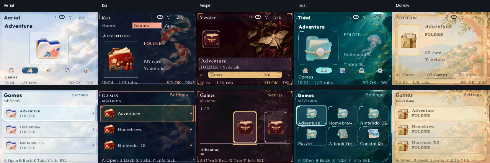

# Gloam Shell Theme Directory

A home for community-made themes and original themes for
[Gloam Shell NDX](https://github.com/nextcode4u/gloam-shell-ndx), the Nintendo DSi SD-card frontend.

The collection includes five new illustrated themes and three Gloam starter themes.
Community submissions are welcome;
there are no community entries yet. Themes from AKMenu, TWiLight Menu++ or other
frontends are not directly compatible with Gloam’s format.

## Art collection



These previews show the actual host renderer with synthetic content. Each theme
includes original music, UI cues and its own material/icon treatment. The updated
packs use translucent components, separate body/heading faces, independent screen
opacity and additional top-screen compositions.

## Browse themes

| Theme | Style | Author |
| --- | --- | --- |
| [Aerial](themes/aerial) | Cloud study | Gloam project (AI-assisted) |
| [Koi](themes/koi) | Still water | Gloam project (AI-assisted) |
| [Vesper](themes/vesper) | The velvet hour | Gloam project (AI-assisted) |
| [Tidal](themes/tidal) | Below the surface | Gloam project (AI-assisted) |
| [Morrow](themes/morrow) | A slower morning | Gloam project (AI-assisted) |
| [Slate](themes/slate) | Rain-soaked city archive; cool blue accents | Gloam project |
| [Folio](themes/folio) | Botanical field notebook; light palette | Gloam project |
| [Phosphor](themes/phosphor) | Green radar station; terminal-like contrast | Gloam project |

Each theme page includes wallpaper previews, installation instructions and credits.
Slate, Folio and Phosphor extend their original Gloam designs with the same new
capabilities. These revisions are optional packs, separate from Gloam’s bundled themes.


## Install

**These revisions require the updated Gloam build with theme format 2. They do not
load in Gloam 1.0.0.** The matching frontend changes are in
[Gloam commit `1d18cc4`](https://github.com/nextcode4u/gloam-shell-ndx/commit/1d18cc4743be705df1466fbf44f4ace9c79c974d).
Until a matching release is published, build that revision or later, or choose the
[original 1.0-compatible collection](https://github.com/nextcode4u/gloam-shell-theme-directory/tree/74fd2dd/themes).

1. Choose **Code → Download ZIP**, then extract the archive on your computer.
2. Copy the desired folder from `themes/` to `/_nds/dsi-frontend/themes/` on your SD card.
   For example: `/_nds/dsi-frontend/themes/folio/theme.ini`.
3. Start Gloam and open **START → Appearance → Theme**. Up/Down previews; A applies.

Copy the whole theme folder, including its assets. Back up any theme with the same
folder name before replacing it. Do not copy this repository over your SD root.
Gloam 1.0 displays the alphabetically first 23 valid theme folders plus Built-in;
keep only the themes you want installed if you reach that limit.

## Splash Builder

Create static or animated startup splashes with images, GIFs, numbered frames,
independent layer motion and optional WAV audio. Fit/crop/stretch/native sizing,
start/end scale and opacity, position, timing, easing and repeat controls make
each screen and overlay independently editable. The graphical builder and converter live
here; playback lives in Gloam. On Windows, open PowerShell and run:

```powershell
irm https://raw.githubusercontent.com/nextcode4u/gloam-shell-theme-directory/main/splash.ps1 | iex
```

Choose or create a working folder. Your imported artwork and project settings
are saved there automatically; run the command again and select that folder to
continue. **Save project** saves immediately. Missing Python or image-processing
dependencies are offered for installation before the builder opens. Installation
requires your choice; the tool uses its own Python environment.

You can also run from this repository's root:

```sh
python -m pip install -r requirements.txt
python tools/pack_splash.py
```

Use Python 3.10+ with Tk (included in the standard Windows Python installer).
Running without arguments opens the graphical builder and working-folder picker.
See the [splash authoring guide](docs/STARTUP_SPLASHES.md)
for saved projects, offline startup, preview, theme export and custom SD installation. Splash playback requires
a Gloam build after 1.0.0; new motion exports additionally require
`GLOMSP02` support. The 1.0.0 release does not support splashes.

## Share a theme

Read [CONTRIBUTING.md](CONTRIBUTING.md), then open a pull request. Keep the theme
self-contained, include previews and credits, and describe the Gloam version and
hardware or emulator used for testing. An issue can also be used to discuss a
submission before preparing a pull request.

The authoritative [theme format guide](https://github.com/nextcode4u/gloam-shell-ndx/blob/main/docs/guides/THEME_PACKAGES.md)
lives with Gloam’s source. [catalog.json](catalog.json) lists the entries and their
requirements; it is not yet connected to an automatic theme downloader.

## Credits and licenses

Authors keep credit for their work. Every submission must document its licenses
and permission to share included assets. See [LICENSES.md](LICENSES.md) and each
theme’s CREDITS.md. This directory does not relicense community work.

## Developer note

This project was developed with assistance from AI language models. Some source
code and documentation were generated or refined using AI, with the resulting
work reviewed and integrated by the project author where appropriate.

## Building packs

See [authoring and validation](docs/AUTHORING.md) for reproducible asset builds,
renderer checks and local install ZIP generation. Generated ZIPs stay out of Git.
