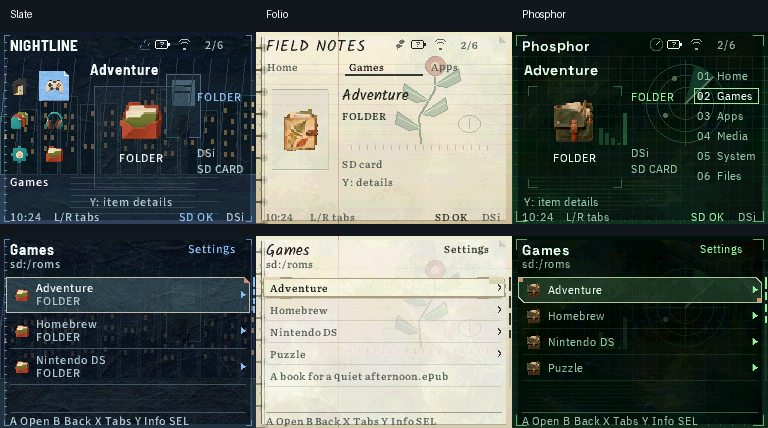

# Gloam Shell Theme Directory

A home for community-made themes and original themes for
[Gloam Shell NDX](https://github.com/nextcode4u/gloam-shell-ndx), the Nintendo DSi SD-card frontend.

The directory includes five original illustrated themes, three updated Gloam starter themes,
and a credited BUUF adaptation.
Community submissions are welcome;
there are no community entries yet. Themes from AKMenu, TWiLight Menu++ or other
frontends are not directly compatible with Gloam’s format.

## Art collection


These previews show the actual host renderer with synthetic content. Each theme
includes licensed background music, original UI cues and its own material/icon treatment. The updated
packs use translucent components, separate body/heading faces, independent screen
opacity and additional top-screen compositions. Image-backed reading surfaces,
matching control sprites and a small ambient header accent give each pack its
own material treatment. Each pack now has independently illustrated icons and
a distinct font pairing. Full-image material masks preserve continuous detail
across rows and panels; selections use complete themed skins. Prepared bundles include preblended screens and material fields, reducing PNG decoding and small-file loading;
Reduced motion holds the ambient accent still.

## Browse themes

| Theme | Style | Author |
| --- | --- | --- |
| [Aerial](themes/aerial) | Pearl glass and open clouds | Gloam project (agent-assisted) |
| [Koi](themes/koi) | Coral lacquer and ink-blue water | Gloam project (agent-assisted) |
| [Vesper](themes/vesper) | Velvet, moths and brass fittings | Gloam project (agent-assisted) |
| [Tidal](themes/tidal) | Sea-glass lenses and jellyfish | Gloam project (agent-assisted) |
| [Morrow](themes/morrow) | A slower morning | Gloam project (agent-assisted) |
| [Slate](themes/slate) | City archive; folded labels and left icon rail | Gloam project |
| [Folio](themes/folio) | Botanical notebook; translucent tracing paper | Gloam project |
| [Phosphor](themes/phosphor) | Radar instruments; open brackets and segmented controls | Gloam project |
| [BUUF](themes/buuf) | Hand-drawn objects, worn paper, leather and moss-green labels | mattahan icons; upstream fana-m / oxayotl; Gloam adaptation |

## Desktop and device collection


| Theme | Personality |
| --- | --- |
| [Luna XP](themes/luna) | Cobalt title bars, cream Explorer windows, pale-blue navigation and compact shell icons |
| [Desktop 98](themes/desktop-98) | Teal desktop, raised gray controls, navy selections and pixel icons |
| [Classic DS](themes/classic-ds) | Gray grid, silver panels, flat monochrome icons and blue-gray selection corners |
| [Portal Terminal](themes/portal-terminal) | Flat cartoon alien landscape, lavender skies, peach panels and lime portal highlights |
| [Aero Glass](themes/aero-glass) | Blue-green ribbons, pearl glass cards and luminous shell objects |
| [Pokédex](themes/pokedex) | Red/ivory research-device casing, celadon screens and blue sensors |
| [Synthwave](themes/synthwave) | Plum surfaces, hot-pink highlights, electric cyan and a magenta coastal sunset |

These are original, unofficial interpretations with separate icon sets, controls,
font pairs, recorded music, UI cues and short startup splashes. No extracted
operating-system/franchise artwork or audio is included. Luna requires a source build with the new header/footer theme colors
(commit `99a5fab` or later); the other six support **Gloam 1.1.0 or later**.
Names and marks remain with their respective owners.
Previews use the current source build, which also fixes selection-text contrast
in settings and other menus; that fix is not present in the original 1.1.0 binary.

Each theme page includes wallpaper previews, installation instructions and credits.
Slate, Folio and Phosphor extend their original Gloam designs with the same new
capabilities. These revisions are optional packs, separate from Gloam’s bundled themes.



## BUUF


Original icons by [mattahan](https://www.deviantart.com/mattahan), distributed through
[oxayotl’s BUUF icon theme](https://github.com/oxayotl/buuf-icon-theme).
The adapted artwork uses **CC-BY-NC-SA-2.5**, with attribution, noncommercial and
ShareAlike terms. Its standalone pack includes the full notice and source provenance;
it is separate from the original-art and starter collection ZIPs.
See [BUUF credits](themes/buuf/CREDITS.md).

## Install

**These revisions require Gloam 1.1.0 or a newer build with full-image
material support. They do not load in Gloam 1.0.0.** Use the current release or build
[Gloam `6aacad1` or later](https://github.com/nextcode4u/gloam-shell-ndx/commit/6aacad1e965ddcf36553637ab17ccd475936602c),
or use the [original 1.0-compatible collection](https://github.com/nextcode4u/gloam-shell-theme-directory/tree/74fd2dd/themes).

1. Choose **Code → Download ZIP**, then extract the archive on your computer.
2. Copy the desired folder from `themes/` to `/_nds/dsi-frontend/themes/` on your SD card.
   For example: `/_nds/dsi-frontend/themes/folio/theme.ini`.
3. Start Gloam and open **START → Appearance → Theme**. Up/Down selects; X previews; A applies when ready.

Copy the whole theme folder, including its assets. Back up any theme with the same
folder name before replacing it. Do not copy this repository over your SD root.
Gloam 1.0/1.1.0 displays the alphabetically first 23 valid theme folders plus
Built-in. Newer source builds expand this to 64 installed themes plus Built-in;
keep a selection installed if your build still has the earlier limit.

Each pack also includes a lightweight, 1.2-second startup intro using its own
artwork and typography. Choose **Startup splash → Theme** in Gloam; **Preview
splash** lets you try it without restarting. See the [splash guide](docs/STARTUP_SPLASHES.md).

## Splash Builder

Create static or animated startup splashes with images, GIFs, numbered frames,
independent layer motion and optional WAV audio. Fit/crop/stretch/native sizing,
start/end scale and opacity, position, timing, easing and repeat controls make
each screen and overlay independently editable. The graphical builder and converter live
here; playback lives in Gloam. On Windows, open PowerShell and run:

```powershell
irm https://raw.githubusercontent.com/nextcode4u/gloam-shell-theme-directory/main/splash.ps1 | iex
```

Choose or create a working folder. Your imported artwork and project settings
are saved there automatically; run the command again and select that folder to
continue. **Save project** saves immediately. Missing Python or image-processing
dependencies are offered for installation before the builder opens. Installation
requires your choice; the tool uses its own Python environment.

You can also run from this repository's root:

```sh
python -m pip install -r requirements.txt
python tools/pack_splash.py
```

Use Python 3.10+ with Tk (included in the standard Windows Python installer).
Running without arguments opens the graphical builder and working-folder picker.
See the [splash authoring guide](docs/STARTUP_SPLASHES.md)
for saved projects, offline startup, preview, theme export and custom SD installation. Splash playback requires
a Gloam build after 1.0.0; new motion exports additionally require
`GLOMSP02` support, and automatically compressed exports require `GLOMSP03`.
Compression retains every prepared frame while reducing SD/package size.
The 1.0.0 release does not support splashes.

## Rebuild the desktop/device collection

Install `requirements.txt`, then use the matching Gloam checkout for its native
font/sprite packers:

```sh
python tools/build_inspired_collection.py --gloam /path/to/gloam --download-fonts
python tools/prepare_theme_music.py
python tools/package_collection.py
```

Classic DS uses original code-authored grid and glyph masters; regenerate them
with `python tools/classic_ds_assets.py` before rebuilding that pack.

Artwork masters and hashes are under `source/art` and `config/inspired-art.json`;
`config/inspired-themes.json` holds authored layouts/palettes. Recorded music
is preserved during ordinary builds; `prepare_theme_music.py --rebuild --download`
reproduces its pinned loops separately. Authoring does not install anything to SD.

Packaging creates each theme ZIP and `dist/gloam-desktop-device-themes.zip`, with
credits and notices but no preview screenshots. To render selected previews,
first run Gloam’s host checks, then use `tools/render_previews.py --gloam` with
`--only` followed by the desired theme IDs. `--gallery docs/inspired-preview.png`
sets a combined preview destination. Omitting `--only` renders all sixteen packs.

## Share a theme

Read [CONTRIBUTING.md](CONTRIBUTING.md), then open a pull request. Keep the theme
self-contained, include previews and credits, and describe the Gloam version and
hardware or emulator used for testing. An issue can also be used to discuss a
submission before preparing a pull request.

The authoritative [theme format guide](https://github.com/nextcode4u/gloam-shell-ndx/blob/main/docs/guides/THEME_PACKAGES.md)
lives with Gloam’s source. [catalog.json](catalog.json) lists the entries and their
requirements; it is not yet connected to an automatic theme downloader.

## Credits and licenses

Authors keep credit for their work. Every submission must document its licenses
and permission to share included assets. See [LICENSES.md](LICENSES.md) and each
theme’s CREDITS.md. This directory does not relicense community work.

## Developer note

This project was developed with assistance from AI language models. Some source
code and documentation were generated or refined using AI, with the resulting
work reviewed and integrated by the project author where appropriate.

## Building packs

See [authoring and validation](docs/AUTHORING.md) for reproducible asset builds,
renderer checks and local install ZIP generation. Generated ZIPs stay out of Git.
