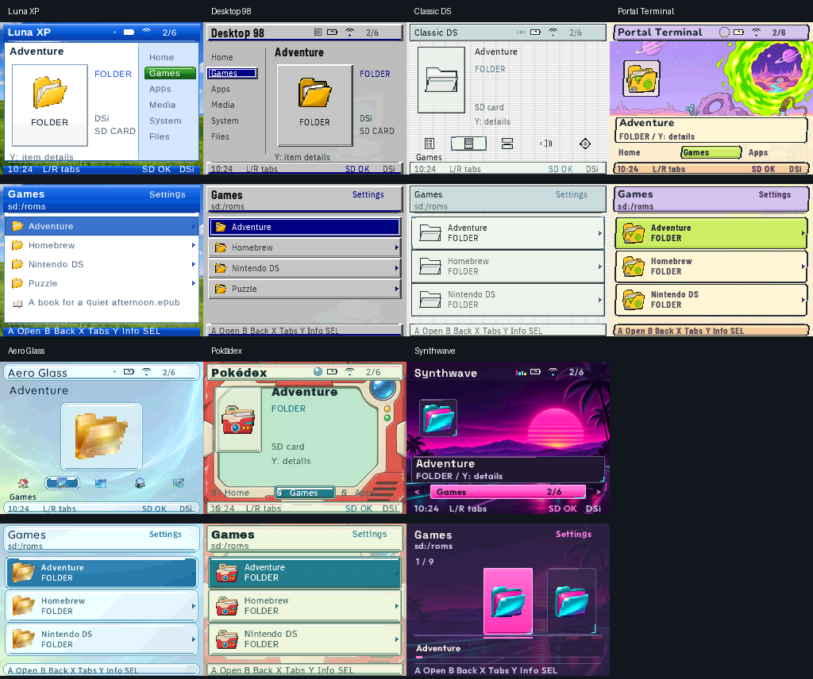
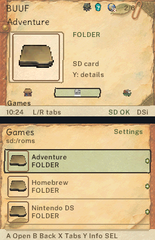
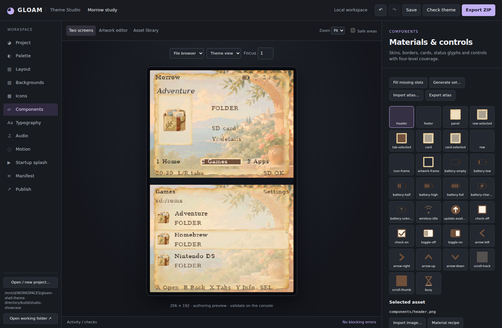

# Gloam Shell Theme Directory

A home for community-made themes and original themes for
[Gloam Shell NDX](https://github.com/nextcode4u/gloam-shell-ndx), the Nintendo DSi SD-card frontend.

Browse the [complete theme catalog](catalog.json) or the [theme folders](themes/).
Each pack has screenshots, installation instructions and its own credits.
Community submissions are welcome. Gloam themes use their own format.

## Desktop and device collection



| Theme | Personality |
| --- | --- |
| [Luna XP](themes/luna) | Cobalt title bars, cream Explorer windows, pale-blue navigation and compact shell icons |
| [Desktop 98](themes/desktop-98) | Solid gray workspace, navy title bars, raised controls and native pixel-grid icons |
| [Classic DS](themes/classic-ds) | Gray grid, blue-gray status strip, boxed indicators and separate selection brackets |
| [Portal Terminal](themes/portal-terminal) | Flat cartoon alien landscape, lavender skies, peach panels and lime portal highlights |
| [Aero Glass](themes/aero-glass) | Green Aurora desktop, smoky glass trim, neutral Explorer windows and angular shell icons |
| [Pokédex](themes/pokedex) | Red illustrated casing, an unobstructed celadon display and teal selection frames |
| [Synthwave](themes/synthwave) | Plum surfaces, hot-pink highlights, electric cyan and a magenta coastal sunset |

These are original, unofficial interpretations with separate icon sets, controls,
font pairs, recorded music, UI cues and short startup splashes. No extracted
operating-system/franchise artwork or audio is included. Luna, Desktop 98, Classic DS, Aero Glass and Pokédex require **Gloam 1.2.0 or later**
for their separate header/footer colors. Portal Terminal and Synthwave support
**Gloam 1.1.0 or later**.
Names and marks remain with their respective owners.
Use [Gloam 1.2.0](https://github.com/nextcode4u/gloam-shell-ndx/releases/tag/v1.2.0)
to match the previews, including selection-text and numbered-tab fixes.

Each theme page includes renderer previews, installation instructions and credits.
Slate, Folio and Phosphor extend their original Gloam designs with the same new
capabilities. These revisions are optional packs, separate from Gloam’s bundled themes.


## BUUF



Original icons by [mattahan](https://www.deviantart.com/mattahan), distributed through
[oxayotl’s BUUF icon theme](https://github.com/oxayotl/buuf-icon-theme).
The adapted artwork uses **CC-BY-NC-SA-2.5**, with attribution, noncommercial and
ShareAlike terms. Its standalone pack includes the full notice and source provenance;
it is separate from the original-art and starter collection ZIPs.
See [BUUF credits](themes/buuf/CREDITS.md).

## Install

**Use [Gloam 1.2.0 or later](https://github.com/nextcode4u/gloam-shell-ndx/releases/latest)
for the complete collection.** Individual minimum versions are listed in
[catalog.json](catalog.json). These format-2 revisions do not load in Gloam 1.0.0;
the [original 1.0-compatible collection](https://github.com/nextcode4u/gloam-shell-theme-directory/tree/74fd2dd/themes) remains in history.

1. Choose **Code → Download ZIP**, then extract the archive on your computer.
2. Copy the desired folder from `themes/` to `/_nds/dsi-frontend/themes/` on your SD card.
   For example: `/_nds/dsi-frontend/themes/folio/theme.ini`.
3. Start Gloam and open **START → Appearance → Theme**. Up/Down selects; X previews; A applies when ready.

Copy the whole theme folder, including its assets. Back up any theme with the same
folder name before replacing it. Do not copy this repository over your SD root.
Gloam 1.0/1.1.0 displays the alphabetically first 23 valid theme folders plus
Built-in. Gloam 1.2.0 and later support 64 installed themes plus Built-in;
keep a selection installed if your build still has the earlier limit.

Each pack also includes a lightweight, 1.2-second startup intro using its own
artwork and typography. Choose **Startup splash → Theme** in Gloam; **Preview
splash** lets you try it without restarting. See the [splash guide](docs/STARTUP_SPLASHES.md).

## Theme Studio

Create complete theme packs in a resumable local workspace: palette roles,
layouts, backgrounds, layered artwork, icons, component skins, fonts, audio,
motion and startup splashes. Use visual controls, direct INI editing, imported
artwork, sprite sheets or drawing/material tools. On Windows:

```powershell
irm https://raw.githubusercontent.com/nextcode4u/gloam-shell-theme-directory/main/theme.ps1 | iex
```

Choose a working folder to create or resume a project. The builder opens in your
browser; its Python process runs locally. Dependency installation is offered when
needed. ZIP export rebuilds prepared assets and keeps source masters/layers on the
PC. The existing Splash Builder opens from the same project. See the
[Theme Studio guide](docs/THEME_STUDIO.md) for tools, offline launch, preview
limitations, validation, native checks and SD installation.



## Splash Builder and reproducible builds

Theme Studio includes the Splash Builder for images, GIFs, frame sequences,
layer effects and optional WAV audio. To open it separately on Windows:

```powershell
irm https://raw.githubusercontent.com/nextcode4u/gloam-shell-theme-directory/main/splash.ps1 | iex
```

Both builders save work in the folder you choose and offer dependency setup when
needed. See [splash authoring](docs/STARTUP_SPLASHES.md) for saved projects, offline
use and export. For asset regeneration, native previews and pack ZIPs, see
[authoring and validation](docs/AUTHORING.md).

## Share a theme

Read [CONTRIBUTING.md](CONTRIBUTING.md), then open a pull request. Keep the theme
self-contained, include previews and credits, and describe the Gloam version and
hardware or emulator used for testing. An issue can also be used to discuss a
submission before preparing a pull request.

The [theme format guide](https://github.com/nextcode4u/gloam-shell-ndx/blob/main/docs/guides/THEME_PACKAGES.md)
lives with Gloam’s source. [catalog.json](catalog.json) lists the entries and their
requirements. Gloam SD Setup 1.2.0 and later can browse this catalog, cache
`preview.png` screenshots before installation, and download individual themes
with their credits and license notices. See the [Windows setup guide](https://github.com/nextcode4u/gloam-shell-ndx/blob/main/docs/guides/WINDOWS_SETUP.md#themes).

## Credits and licenses

Authors keep credit for their work. Every submission must document its licenses
and permission to share included assets. See [LICENSES.md](LICENSES.md) and each
theme’s CREDITS.md. This directory does not relicense community work.

## Developer note

This project was developed with assistance from AI language models. Some source
code and documentation were generated or refined using AI, with the resulting
work reviewed and integrated by the project author where appropriate.
