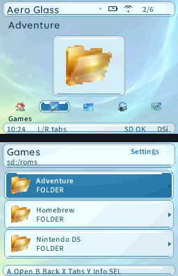

# Aero Glass

Dark green Aurora ribbons, smoky glass window trim, neutral Explorer interiors, pale-blue selections and angular shell icons.

[Home preview](home-preview.png) · [Settings preview](settings-preview.png)

## Install

Requires **Gloam 1.2.0 or later**, including separate header/footer theme colors. Copy this whole folder to
`/_nds/dsi-frontend/themes/aero-glass/`. Open START → Appearance → Theme:
Up/Down selects, X previews and A applies when ready. Existing personal view,
wallpaper or accent overrides can alter the supplied defaults.

Defaults: Gallery top composition, Extended browser,
large icons and icons tabs. Native DS/DSi banner icons keep priority;
theme file/system/category icons cover other entries. Both reading surfaces,
all control skins, eight ambient frames, body/heading fonts, three UI cues,
recorded music and a startup splash are included. Reduced motion is respected.

See [credits](CREDITS.md), [music attribution](MUSIC.md) and original notices.
Illustrations interpret Windows Vista Aero; this is not an official theme.
Previews use Gloam 1.2.0 with separate header/footer inks.
These are renderer captures, not photographs of a DSi LCD.
