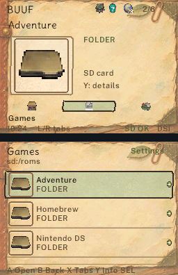
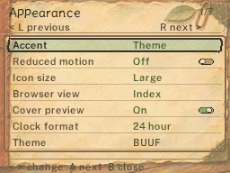

# BUUF

A worn notebook filled with mattahan's chunky, hand-drawn BUUF objects: russet
leather, warm cream paper and moss-green labels. Public Sans keeps the file list
clear while Delius adds handwritten headings. Original BUUF objects also appear
in navigation, batteries, checkboxes and arrows; the small robot-gear header mark
breathes gently. A quiet plucked loop and matching cues complete the pack.

## Install

Requires Gloam's theme format 2 and full-image materials:
[Gloam 6aacad1 or later](https://github.com/nextcode4u/gloam-shell-ndx/commit/6aacad1e965ddcf36553637ab17ccd475936602c).
This revision does not load in Gloam 1.0.0.

Copy this whole folder to `/_nds/dsi-frontend/themes/buuf/`, then select **BUUF**
under **START → Appearance → Theme**. Reduced motion holds the header mark still;
background music and UI sounds follow your audio preferences.

## Credits and terms

**Original BUUF icons by [mattahan](https://www.deviantart.com/mattahan)**,
from [oxayotl/buuf-icon-theme](https://github.com/oxayotl/buuf-icon-theme).
Upstream also credits fana-m and Hybrid Son Of Oxayotl. Gloam adaptation by
nextcode4u / Gloam contributors, with agent-assisted supporting artwork.

**Artwork: CC-BY-NC-SA-2.5 — noncommercial, attribution and ShareAlike required.**
This is a separate adaptation, not an endorsement. The new supporting illustration
is not mattahan's work. Read [CREDITS.md](CREDITS.md) and
[BUUF-LICENSE.txt](BUUF-LICENSE.txt); preserve both with the theme. Fonts retain
their OFL notices; original synthesized sounds are CC0. The standalone `buuf.zip`
keeps these notices and is separate from the original-art collection archives.
