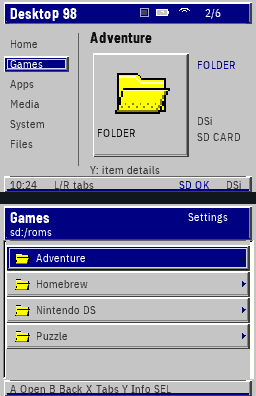

# Desktop 98

A solid gray workspace, navy title bars, raised controls and native pixel-grid shell icons.

[Home preview](home-preview.png) · [Settings preview](settings-preview.png)

## Install

Requires a **Gloam source build with header/footer theme colors** (commit `99a5fab` or later). The original 1.1.0 binary rejects these new keys. Copy this whole folder to
`/_nds/dsi-frontend/themes/desktop-98/`. Open START → Appearance → Theme:
Up/Down selects, X previews and A applies when ready. Existing personal view,
wallpaper or accent overrides can alter the supplied defaults.

Defaults: Sidebar_Left top composition, Classic browser,
small icons and labels tabs. Native DS/DSi banner icons keep priority;
theme file/system/category icons cover other entries.
The desktop and recessed Explorer pane use tiny native UI surfaces without decorative wallpaper.
All control skins, eight ambient frames, body/heading fonts, three UI cues,
recorded music and a startup splash are included. Reduced motion is respected.

See [credits](CREDITS.md), [music attribution](MUSIC.md) and original notices.
Illustrations interpret Windows 98; this is not an official theme.
Previews use the matching Gloam source build with separate chrome inks.
These are renderer captures, not photographs of a DSi LCD.
