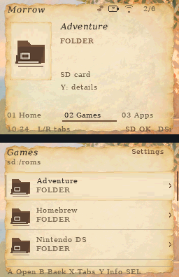

# Morrow

Sunlit illustration behind aged ivory parchment, worn paper selections,
quiet marimba and warm chord voicings.

## Design

- **Journal** composition; numbered navigation at the bottom.
- **Extended** browser by default; other views and icon sizes remain selectable.
- DejaVu Serif body at 10 px, with a separate DejaVu Serif-Italic heading face at 12 px.
- Separate native-size paper assets for the two reading surfaces, with subtle
  grain and translucent edges. PNG alpha supplies the coverage at 100% surface opacity.
- Parchment-strip selection and card assets with a printed margin, aged edges
  and soft shadow. The same selection follows into file pickers and settings.
- Four-level component coverage for translucent cards and layered edges. Modal panels retain solid reading surfaces.
- Native title banners retain priority over themed fallback icons.

Original background music and cursor/confirm/back cues. Select **Audio → Background music → Theme** to hear the loop.

## Install

**Requires Gloam commit `95b2f3b` or later**, including prepared sprites,
control artwork and ambient accents. Gloam 1.0.0 cannot load this revision.
The [format guide](https://github.com/nextcode4u/gloam-shell-ndx/blob/main/docs/guides/THEME_PACKAGES.md)
describes the new capability. The [original 1.0-compatible collection](https://github.com/nextcode4u/gloam-shell-theme-directory/tree/74fd2dd/themes/morrow) remains available in history.

Copy the entire `morrow` folder to `/_nds/dsi-frontend/themes/morrow/` on your SD card,
backing up any existing theme with that name. In Gloam, choose **START → Appearance → Theme**,
select Morrow and press A. Reapply to restore the default view and accent.
Reset personal wallpaper overrides to see the supplied backgrounds.

## Preview and limits

Previews use Gloam's actual renderer and synthetic content. Library index and
item details use the shared index/inspector arrangement. Component coverage blends
existing pixels; there is no live blur. Physical LCD contrast and frame timing
still need testing on a DSi.

[Settings preview](settings-preview.png) · [Credits and licenses](CREDITS.md)

## Materials and feedback

Aged parchment reading surfaces and selections, warm ink controls and a swaying twig.
Controls include matching arrows, switches, checkboxes and scrollbars. Selection
feedback is brief; the ambient accent loads after browsing starts. Reduced motion
freezes the accent and disables the selection gleam. Prepared sprite bundles
reduce file opens while keeping the PNGs editable; rebuild `assets.gfx` after
changing icons or components.
