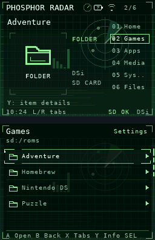

# Phosphor

A green radar station with open instrument brackets, segmented controls and numbered navigation.

The `sidebar` top-screen layout keeps this theme's composition. It
uses an independently illustrated icon set, full-image material surfaces and its
own focus treatment. IBMPlexSansCondensed-Regular body and SpaceGrotesk headings, with Latin-1 coverage.

Original cursor, confirm and back cues are included; no music loop is supplied. Native game banners keep priority over
themed fallback icons.

## Install

Requires **Gloam 1.1.0 or later**, with theme format 2 and full-image
material support. Gloam 1.2.0 is recommended to match the current previews. Gloam 1.0.0 cannot load
this revision. The [original collection](https://github.com/nextcode4u/gloam-shell-theme-directory/tree/74fd2dd/themes/phosphor) remains available in history.

Copy the entire `phosphor` folder to `/_nds/dsi-frontend/themes/phosphor/` on the SD
card. Back up a same-named theme first. Choose **START → Appearance → Theme**,
select Phosphor, press X to preview, then A to apply once ready. Reset personal wallpaper overrides to see the
supplied artwork. Other browser views and icon sizes remain selectable.

See [credits and licenses](CREDITS.md), [authoring](../../docs/AUTHORING.md) and
the [settings preview](settings-preview.png). Host renderer, asset/bounds and
packaging checks cover these packs; physical DSi validation is still needed.

Background music: see [MUSIC.md](MUSIC.md) for the selected track, source and
CC-BY-4.0 attribution. UI-cue and artwork licenses remain separate.
