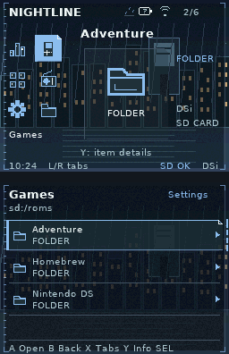

# Slate

A rain-soaked city archive with folded labels, a left icon rail and cool blue accents.

The `sidebar_left` top-screen layout keeps this theme's composition. It
uses an independently illustrated icon set, full-image material surfaces and its
own focus treatment. SourceSans3 body and BarlowSemiCondensed-Bold headings, with Latin-1 coverage.

This pack uses the launcher’s existing audio preferences; no theme audio is supplied. Native game banners keep priority over
themed fallback icons.

## Install

Requires [Gloam `6aacad1` or later](https://github.com/nextcode4u/gloam-shell-ndx/commit/6aacad1e965ddcf36553637ab17ccd475936602c),
with theme format 2 and full-image material support. Gloam 1.0.0 cannot load
this revision. The [original collection](https://github.com/nextcode4u/gloam-shell-theme-directory/tree/74fd2dd/themes/slate) remains available in history.

Copy the entire `slate` folder to `/_nds/dsi-frontend/themes/slate/` on the SD
card. Back up a same-named theme first. Choose **START → Appearance → Theme**,
select Slate and press A. Reset personal wallpaper overrides to see the
supplied artwork. Other browser views and icon sizes remain selectable.

See [credits and licenses](CREDITS.md), [authoring](../../docs/AUTHORING.md) and
the [settings preview](settings-preview.png). Host renderer, asset/bounds and
packaging checks cover these packs; physical DSi validation is still needed.

Background music: see [MUSIC.md](MUSIC.md) for the selected track, source and
CC-BY-4.0 attribution. UI-cue and artwork licenses remain separate.
