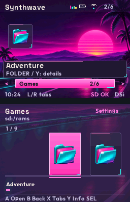

# Synthwave

Deep plum surfaces, hot-pink selections, electric cyan reflections, mint status lights and a magenta coastal sunset.

[Home preview](home-preview.png) · [Settings preview](settings-preview.png)

## Install

Requires **Gloam 1.1.0 or later**. Copy this whole folder to
`/_nds/dsi-frontend/themes/synthwave/`. Open START → Appearance → Theme:
Up/Down selects, X previews and A applies when ready. Existing personal view,
wallpaper or accent overrides can alter the supplied defaults.

Defaults: Scene top composition, Shelf browser,
large icons and pager tabs. Native DS/DSi banner icons keep priority;
theme file/system/category icons cover other entries. Both reading surfaces,
all control skins, eight ambient frames, body/heading fonts, three UI cues,
recorded music and a startup splash are included. Reduced motion is respected.

See [credits](CREDITS.md), [music attribution](MUSIC.md) and original notices.
Illustrations interpret 1980s airbrush artwork and synthwave record sleeves; this is not an official theme.
Previews use Gloam 1.2.0 with selection-ink fixes for menus and settings.
These are renderer captures, not photographs of a DSi LCD.
